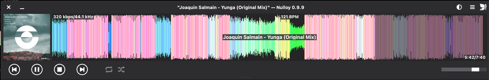
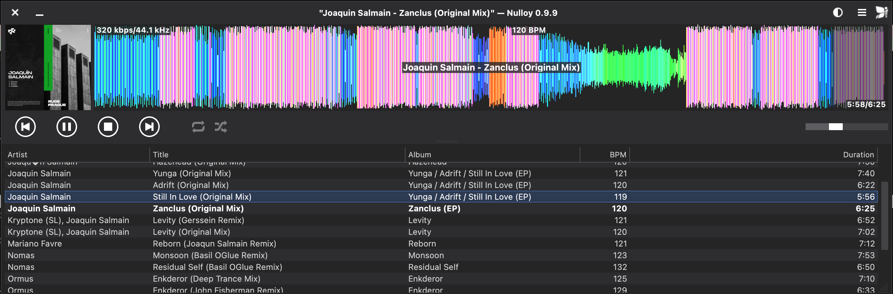

# Nulloy Music Player

## What's new in this fork

This fork adds the features below to [Nulloy](https://github.com/nulloy/nulloy). A macOS build is available in the **[latest release](https://github.com/khoshekh-dj/nulloy/releases/latest)** (Apple Silicon only).

### RGB waveform
The waveform is coloured by frequency content, with bass in red, mids in green and highs in blue. Turn it on in Preferences → *Color waveform by frequency*.



### Playlist columns
The playlist can show Artist, Title, Album, BPM and Duration from your tags, in resizable columns. Turn it on in Preferences → *Show playlist as columns*.



### Also
- **Mac media keys and Now Playing**: F7, F8 and F9, headphone buttons and Control Center can play, pause and skip tracks.
- **BPM from tags**: add `{%M BPM}` to a waveform section in Preferences.
- **Crash fix**: blank global shortcuts were registered as the "A" key system-wide, which made typing "a" pop up the player and could crash the app.
- **Self-contained macOS packaging**: `scripts/package-mac.sh` builds a standalone `.app` and `.dmg` (see [macOS packaging](#macos-packaging) below).

---


More screenshots: https://nulloy.com/screenshots/

## Build Instructions

<details>
<summary>Windows</summary>

### Prerequisites

* Qt 5 offline installer https://www.qt.io/offline-installers/
* GStreamer 1.0 MinGW 32-bit (runtime and development installers) http://gstreamer.freedesktop.org/download/
* pkg-config and its dependencies (glib and gettext-runtime) https://download.gnome.org/binaries/win32/dependencies/, https://download.gnome.org/binaries/win32/glib/
* CMake http://www.cmake.org/
* TagLib source code https://github.com/taglib/taglib/
* ImageMagick https://imagemagick.org/script/download.php#windows
* 7zip http://www.7-zip.org/

Disconnect from the Internet to skip creating Qt account. Run Qt 5 offline installer and select only the following components:
```
+ Qt
  + Qt 5
    - Qt Prebuilt Components for MinGW 32-bit
    - Qt Script
  + Developer and Designer Tools
    - MinGW 32-bit toolchain
```

Extract pkg-config and its dependencies into `C:\Downloads\pkg-config`.

Install GStreamer runtime and development packages. Open command prompt and execute:
```bat
del C:\gstreamer\1.0\mingw_x86\lib\libstdc++.a
```

Extract and / or install the rest of the prerequisites.

### Build TagLib

Run Qt MinGW terminal and execute:

```bat
C:\Downloads\taglib
cmake.exe -G "MinGW Makefiles" -DCMAKE_BUILD_TYPE=Release -DBUILD_SHARED_LIBS=ON -DZLIB_INCLUDE_DIR=C:\gstreamer\1.0\mingw_x86\include -DCMAKE_INSTALL_PREFIX="."
mingw32-make
mingw32-make install
```

### Build & Run Nulloy

In the same terminal execute:

```bat
set PATH=C:\Program Files\7-Zip;%PATH%
set PATH=C:\gstreamer\1.0\mingw_x86\bin;%PATH%
set PATH=C:\Downloads\pkg-config\bin;%PATH%
set PKG_CONFIG_PATH=C:\gstreamer\1.0\mingw_x86\lib\pkgconfig;%PKG_CONFIG_PATH%
set PKG_CONFIG_PATH=C:\Downloads\taglib\lib\pkgconfig;%PKG_CONFIG_PATH%
set GST_PLUGIN_PATH=C:\gstreamer\1.0\mingw_x86\lib

cd C:\Downloads\nulloy
configure.bat
mingw32-make
copy /B /Y C:\gstreamer\1.0\mingw_x86\bin\*.dll .
del libstdc++-6.dll
copy /B /Y C:\Downloads\taglib\bin\libtag.dll .
windeployqt Nulloy.exe
Nulloy.exe
```
</details>

<details>
<summary>macOS</summary>

### Prerequisites
* Xcode Command Line Tools
* MacPorts http://www.macports.org/ or HomeBrew https://brew.sh/

### Environment

Install Xcode Command Line Tools:

```sh
xcode-select --install
```

### Dependences

First install either MacPorts or HomeBrew.

### MacPorts

After installing MacPorts:

```sh
sudo port install pkgconfig qt5 qt5-qtscript qt5-qttools gstreamer1 gstreamer1-gst-plugins-base taglib ImageMagick librsvg
export PATH=/opt/local/libexec/qt5/bin:$PATH
# install extra GStreamer plugins for more audio formats
sudo port install gstreamer1-gst-plugins-good gstreamer1-gst-plugins-bad gstreamer1-gst-plugins-ugly

cd nulloy.git
./configure
make
open nulloy.app
```

### HomeBrew

After installing HomeBrew:

```sh
brew install pkgconfig qt5 gstreamer gst-plugins-base taglib imagemagick librsvg
export PATH=/usr/local/opt/qt/bin:$PATH
# install extra GStreamer plugins for more audio formats
brew install gst-plugins-good gst-plugins-bad gst-plugins-ugly

cd nulloy.git
./configure
make
open nulloy.app
```

On Apple Silicon, Homebrew installs Qt 5 as `qt@5` under `/opt/homebrew`. Use these steps instead:

```sh
brew install qt@5 gstreamer taglib imagemagick librsvg
export PATH="$(brew --prefix qt@5)/bin:$PATH"
./configure
make
```

### macOS packaging

To build a standalone `Nulloy.app` and `Nulloy.dmg` that run without Homebrew, start from a Homebrew build as above:

```sh
scripts/package-mac.sh "$PWD/nulloy.app" "$PWD/dist/Nulloy"
# -> dist/Nulloy.dmg
```

The script:
- bundles Qt and an audio-only set of GStreamer plugins
- strips local settings and playlists
- checks that nothing still depends on Homebrew
- ad-hoc signs the app

The result is not notarized, so on first launch right-click the app and choose **Open**. It runs on the same CPU architecture as the Homebrew it was built from.

### Xcode

Generate Xcode project file:

```sh
cd nulloy.git
./configure --xcode
open nulloy.xcodeproj
```
Build `widget_collection`, `plugin_taglib` and `plugin_gstreamer` targets. It may take several attempts to build, but it should succeed eventually.
Build and run `nulloy` target.
</details>

<details>
<summary>Linux</summary>

### Dependences

#### DEB-based distro

```sh
apt install g++ qttools5-dev qtscript5-dev qtbase5-private-dev libqt5x11extras5-dev libgstreamer-plugins-base1.0-dev libgstreamer1.0-dev zip libx11-dev libx11-xcb-dev libtag1-dev imagemagick librsvg2-bin libqt5svg5-dev
# install extra GStreamer plugins for more audio formats
apt install gstreamer1.0-plugins-good gstreamer1.0-plugins-bad gstreamer1.0-plugins-ugly
```

#### RPM-based distro

```sh
yum install gcc-c++ qt5-qtbase-devel qt5-qttools-devel qt5-qttools-static qt5-qtscript-devel qt5-qtbase-private-devel qt5-linguist gstreamer1-plugins-base-devel gstreamer1-devel zip libX11-devel libxcb-devel taglib-devel ImageMagick librsvg2 qt5-qtsvg-devel
# install extra GStreamer plugins for more audio formats
yum install gstreamer1-plugins-good gstreamer1-plugins-bad gstreamer1-plugins-ugly
```

### Build & Run Nulloy

```sh
cd nulloy.git
./configure
make
./nulloy
```
</details>

## License
[GPL3](/LICENSE.GPL3)
